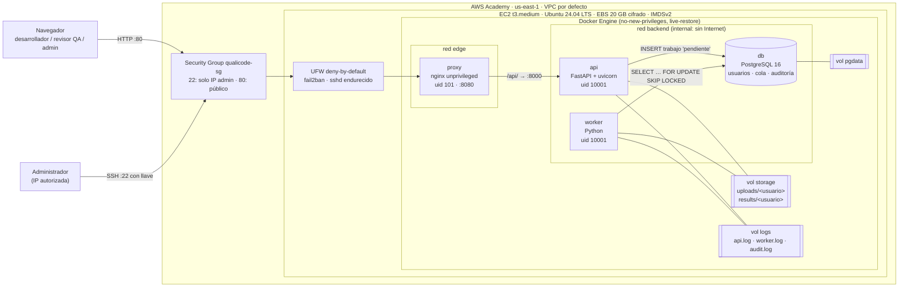

# Arquitectura y decisiones · QualiCode

## 1. Identidad del caso (sello de autenticidad)

| | |
|---|---|
| **Organización** | QualiCode S.A.S. (ficticia): empresa de aseguramiento de calidad (QA) de software para equipos de desarrollo |
| **Necesidad** | Recibir métricas de los pipelines de integración continua, calcular indicadores (cobertura, complejidad, defectos) y entregar informes de calidad confiables, con trazabilidad de quién revisó cada uno |
| **Incidentes previos** | Desarrolladores que veían métricas de otros proyectos, informes entregados sin revisión QA, procesos que saturaban el servidor y sin registro de quién hizo qué |
| **Desarrollador** (Usuario) | Sube las métricas de su repositorio y descarga sus informes ya liberados |
| **Revisor QA** (Operador) | Revisa los informes de todos, los libera, reintenta trabajos fallidos y monitorea la cola |
| **Administrador** (TI) | Gestiona usuarios y roles, consulta la auditoría y el estado del sistema. **No** lee el contenido de los informes |

## 2. Modelo de servicio: IaaS

Se usa **IaaS (Amazon EC2)**: AWS entrega la máquina virtual, la red (VPC, Security Group) y el disco
(EBS), y el equipo administra **el sistema operativo Linux, Docker, los usuarios, el firewall y las
actualizaciones**.

**Justificación:** el curso evalúa la administración del SO (procesos, usuarios, permisos, hardening,
recursos). Un PaaS (Elastic Beanstalk, App Runner) o una base de datos administrada (RDS) ocultaría
justamente esas capas. Además, el Learner Lab restringe varios servicios PaaS.

## 3. Diagrama



### Flujo de un trabajo

1. El desarrollador inicia sesión. La API verifica el hash Argon2id y emite un JWT en una cookie
   `HttpOnly` y `SameSite=Strict`.
2. Carga un archivo. La API valida extensión, tamaño, firma binaria, UTF-8 y esquema CSV; lo guarda
   en `uploads/<id_usuario>/<uuid>.csv` con permisos 640; inserta el trabajo como **pendiente** y
   **responde de inmediato** (HTTP 201).
3. El worker reclama el trabajo (`en_ejecucion`), verifica el SHA-256 del original, procesa y escribe
   `results/<id_usuario>/<uuid>.json`. El estado pasa a **completado**, o a **fallido** con el motivo.
4. Un revisor QA revisa el resultado y lo **libera**. Solo entonces el desarrollador puede descargarlo.
5. Cada paso queda en `audit_log` y en `audit.log`.

## 4. Decisión de arquitectura principal: la cola de trabajos en PostgreSQL

**Decisión:** no se agrega Redis ni RabbitMQ. La tabla `jobs` es la cola, y los trabajadores reclaman
trabajos con:

```sql
UPDATE jobs SET status='en_ejecucion', worker_id=$1, attempts=attempts+1, started_at=now()
WHERE id = (SELECT id FROM jobs WHERE status='pendiente'
            ORDER BY created_at FOR UPDATE SKIP LOCKED LIMIT 1)
RETURNING ...
```

| Criterio | PostgreSQL + SKIP LOCKED (elegido) | Redis / RabbitMQ |
|---|---|---|
| Durabilidad | Transaccional, en el volumen `pgdata` | Redis pierde mensajes sin AOF; RabbitMQ requiere colas durables |
| Consistencia | El estado del trabajo y la cola son **la misma fila**: imposible desincronizarlos | Dos fuentes de verdad (cola + BD) |
| Superficie de ataque | 4 contenedores | +1 servicio, +1 credencial, +1 puerto interno |
| Memoria | 0 MB extra | ~30–100 MB extra |
| Paralelismo | `--scale worker=N` sin trabajos duplicados (SKIP LOCKED) | Igual |
| Límite | Sondeo cada 1 s; adecuado hasta miles de trabajos/hora | Mejor para volúmenes muy altos |

Para la carga de QualiCode (decenas o cientos de análisis al día) la ganancia de un broker dedicado no
compensa la complejidad ni el riesgo adicional.

**Recuperación:** al iniciar, y cada 30 s, el worker devuelve a `pendiente` los trabajos que quedaron
`en_ejecucion` por un worker que ya no envía latido (máximo 3 intentos). Esto se demuestra con
`tests/prueba_recuperacion.py` (prueba R2, `docker kill`).

### Decisiones complementarias

| Decisión | Motivo |
|---|---|
| Imágenes propias para proxy y db (no bind-mounts de código) | Inmutables y reproducibles; no dependen de los permisos del host |
| Red `backend` con `internal: true` | El worker y la BD no tienen salida a Internet (contención ante compromiso) |
| IMDSv2 obligatorio con hop limit 1 y sin instance profile | Los contenedores no pueden obtener credenciales de AWS desde la metadata |
| UUID como ID de trabajo | Evita enumerar IDs. Aun así, la autorización se verifica en el servidor |
| Respuesta 404 (no 403) ante un trabajo ajeno | No revela que el trabajo existe; el intento queda auditado como `ACCESO_AJENO` |
| `token_version` en la tabla de usuarios | Cerrar sesión, cambiar el rol o la contraseña revoca todos los tokens al instante |
| Administrador sin `jobs:download_any` | Mínimo privilegio: TI gestiona la plataforma pero no lee los datos agronómicos |
| Comandos docker solo con `sudo` (admin fuera del grupo docker) | Queda rastro en `/var/log/auth.log`; el grupo docker equivale a root |

## 5. Matriz de permisos

Fuente de verdad: [api/security/permissions.py](../api/security/permissions.py). Se aplica en el servidor con `require_perm()`.

| Permiso | Desarrollador | Revisor QA | Admin |
|---|:-:|:-:|:-:|
| `jobs:create`: cargar archivos | ✔ | ✔ | — |
| `jobs:read_own`: ver sus trabajos | ✔ | ✔ | — |
| `jobs:download_own`: descargar lo propio **si está liberado** | ✔ | ✔ | — |
| `jobs:delete_own`: eliminar lo propio | ✔ | ✔ | — |
| `jobs:read_all`: ver metadatos de todos | — | ✔ | ✔ |
| `jobs:download_any`: revisar resultados de cualquiera | — | ✔ | — |
| `jobs:release`: liberar un resultado al desarrollador | — | ✔ | — |
| `jobs:retry`: reencolar trabajos fallidos | — | ✔ | — |
| `jobs:delete_any`: eliminar cualquier trabajo | — | — | ✔ |
| `users:manage`: usuarios y roles | — | — | ✔ |
| `audit:read`: auditoría y reportes | — | — | ✔ |
| `system:status`: estado de la cola y los servicios | — | ✔ | ✔ |

## 6. Reglas de negocio propias (comprobables)

**Regla QualiCode: "ningún informe llega al desarrollador sin revisión QA, y nadie aprueba su propio código".**

1. **Liberación técnica.** Un trabajo `completado` **no** se puede descargar por su dueño desarrollador
   (HTTP 403 y evento `DESCARGA / DENEGADO`) hasta que un revisor QA lo libera (`POST /api/jobs/{id}/release`).
2. **Segregación de funciones.** Nadie puede liberar un análisis que cargó él mismo (HTTP 403 y evento
   `LIBERACION / DENEGADO`).

Controles adicionales del caso:

- **Cuota de cola.** Un desarrollador no puede tener más de 5 trabajos pendientes o en ejecución (HTTP 429
  y evento `CUOTA_EXCEDIDA`). Así ningún usuario acapara el worker.
- **Bloqueo por fuerza bruta.** 5 intentos fallidos en 15 minutos bloquean temporalmente la cuenta
  (`LOGIN_BLOQUEADO`), además del límite de nginx (20 peticiones de login por minuto y por IP).

## 7. Elemento de auditoría propio: la cadena de custodia del análisis

Cada trabajo tiene un rastro completo, consultable con
`GET /api/admin/audit?resource=job:<uuid>` o con el botón **Trazabilidad** de la interfaz:

```
CARGA (desarrollador) → TRABAJO_COMPLETADO (worker:<host>) → DESCARGA DENEGADO (desarrollador, regla)
→ ACCESO_AJENO DENEGADO (otro usuario) → LIBERACION (revisor QA) → DESCARGA OK (desarrollador)
```

Además, el **reporte de actividad** (`/api/admin/audit/report`) resume por usuario los logins, los
intentos fallidos, las cargas, las descargas, las liberaciones y los accesos denegados.
La tabla `audit_log` es **inmutable**: un trigger impide UPDATE y DELETE, y el usuario de BD de la
aplicación solo tiene `SELECT` e `INSERT` sobre ella.
